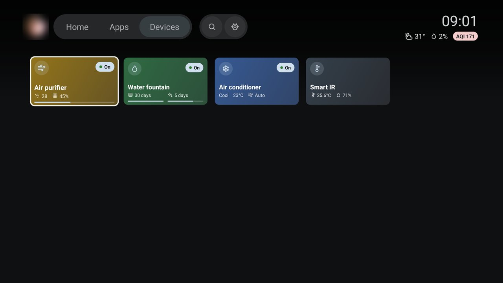
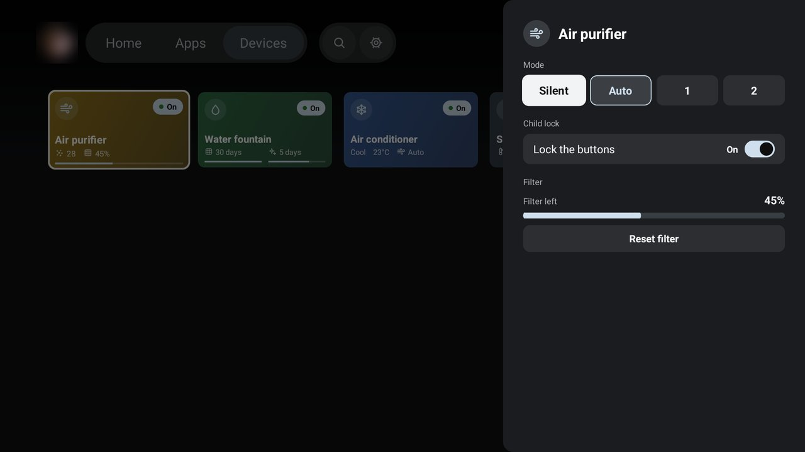
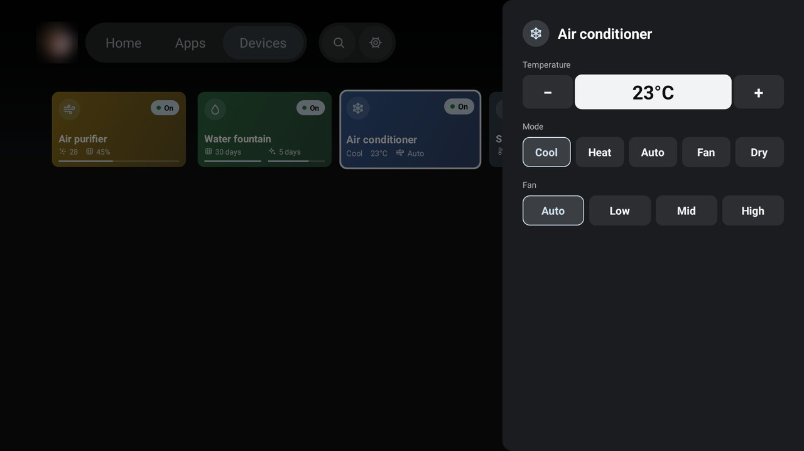

# TCL G09: debloat and TCL Home

Three things for a TCL Google TV (G09), all done over ADB on Wi-Fi and checked on the TV:

- **Debloat.** Disables TCL's bloatware and telemetry, based on
  [cleanyourtv](https://github.com/Gathin23/cleanyourtv) (its `examples/tcl-g09-google-tv` list, same
  firmware). Apps are only **disabled** for user 0, nothing is uninstalled, and `tools/restore.sh` puts the
  TV back the way it was.
- **TCL Home.** A launcher that replaces Google TV's Home: live antenna TV behind everything, with Plex,
  YouTube and Spotify on one screen.
- **Devices.** A tab in TCL Home that shows and controls BARDI (Tuya) smart home devices from the TV.

## Screenshots

| Stock Google TV | After debloat |
|---|---|
|  |  |

| TCL Home: a focused card | TCL Home: Apps tab |
|---|---|
|  |  |

| Holding OK on a tile | Devices tab |
|---|---|
|  |  |

| Purifier options | Air conditioner options |
|---|---|
|  |  |

Live antenna TV cannot be captured (see [Live TV](#live-tv)), so these come from a build with
`show_live_tv` set to `false`, which leaves the background dark. The profile photo is blurred on purpose.

## Contents

- [The TV](#the-tv)
- [What is in the repo](#what-is-in-the-repo)
- [Setup](#setup)
- [Debloat](#debloat)
- [TCL Home](#tcl-home)
- [Devices](#devices)
- [Closing ADB](#closing-adb)

## The TV

| | |
|---|---|
| Model | TCL "Smart TV Pro", device `G09`, product `G09_4K_GB`, Amlogic T5M, 2023 |
| Firmware | Android 12 (SDK 31), `STT2.230203.001.AS24`, software `V8-T800T02-LF1V157` |
| CPU ABI | `armeabi-v7a` (32-bit userspace, armv8l kernel). Native binaries must be 32-bit ARM |
| RAM | 2 GB |
| Stock Home | `com.google.android.apps.tv.launcherx/.home.HomeActivity` |
| Live TV / HDMI | `com.tcl.tv` (player), `com.tcl.tvinput` (HDMI 3/15/16/17 and the tuner) |

## What is in the repo

```
debloat.txt             packages to disable, grouped and commented
tools/lib.sh            TV address (TV_HOST), ADB connection, the `tv` helper, list checks, build_apk
tools/backup.sh         save the TV's state to backup/<time>/
tools/debloat.sh        back up, disable everything in debloat.txt, set Private DNS
tools/restore.sh        put everything back to the earliest backup
tools/screenshot.sh     press remote keys, then save a screenshot to shots/<name>.png
tools/build-install.sh  build TCL Home, install it, make it Home, check it on screen
tools/tvprobe.sh        check what Continue watching, channel and antenna data a launcher can read
tools/plex-check.py     check what a launcher can get from the Plex server (token in plex.local)
tools/tuya-login.py     log in to Smart Life with a QR code; save the session and devices with local keys
tools/smart-home.sh     send the Tuya devices and the cloud session to the TV
launcher/               TCL Home; launcher/res/values/config.xml holds every setting
docs/screenshots/       images for this README
```

`plex.local` (the Plex token), `backup/` (serial number and device identity) and `shots/` (account and
Wi-Fi names) are in `.gitignore`.

## Setup

1. Mac: `brew install android-platform-tools`.
2. TV: Settings → System → About → click "Android TV OS build" 7 times → back → Developer options → turn
   on **USB debugging**.
3. The first connection shows "Allow USB debugging?" on the TV. Tick "Always allow" and press OK.
4. The TV's address is in `tools/lib.sh`. If DHCP moves it, run with `TV_HOST=<tv-ip> tools/debloat.sh`,
   or reserve the address in the router.
5. For TCL Home only: JDK 17 and the Android SDK. `brew install openjdk@17`,
   `brew install --cask android-commandlinetools`, then
   `sdkmanager "platforms;android-34" "build-tools;34.0.0"`.

## Debloat

```bash
tools/debloat.sh                 # back up, disable everything in debloat.txt, set Private DNS
tools/restore.sh                 # back to the state before the first debloat
tools/backup.sh                  # back up only
tools/screenshot.sh 01-home HOME # press HOME, save shots/01-home.png
```

- `debloat.sh` is safe to run again (after a factory reset, say): packages that are already disabled or not
  installed are skipped, and at the end it compares the TV's disabled list with `debloat.txt` and fails if
  anything is still on. It takes another list as an argument, and `PRIVATE_DNS= tools/debloat.sh` leaves
  DNS alone.
- `restore.sh` uses the earliest backup, or the one given: `tools/restore.sh backup/20261022-185411`.

### What gets disabled

32 packages (30 changed, 2 were disabled from the factory).

| Group | Packages |
|---|---|
| TCL telemetry | `ttvs` (BI and identifiers), `logkit` (log upload), `interactive` (TIAS), Google feedback, Ginga (ISDB-Tb broadcast apps, unused on DVB-T2) |
| TCL content and promotion | TCL Live FAST channels, waterfall, content pushed to Home, `partnercustomizer` (the "TCL" tab on Home), messagebox, partner auto-install |
| Background services | TGuard, EULA, TCL account, store demo and stickers, hotel mode, Alexa |
| Preloaded apps | e-manual, repair guide, game bar, TCL soundbar updater, hearing test, TalkBack, Play Games, YouTube Music, Ambient mode (`dreamx`) |
| By choice | Prime Video, Miracast, MagiConnect, TCL USB media player |
| Third-party launcher | AT4K Launcher (`com.overdevs.at4k`), installed by hand; disabled so Google TV is Home again |

Firmware updates on this build come through Play Services, so `ttvs` is safe to disable.

**Left alone on purpose:** Netflix, YouTube, Google TV/Play Movies, Chromecast (`mediashell`), AirPlay,
the phone remote (`com.google.android.tv.remote.service`, also the physical remote's mic path), Google
Assistant (`katniss`), antenna channel scan (`com.tcl.initsetup`); everything the TV needs (`com.tcl.tv`,
`com.tcl.tvinput`, `com.tcl.suspension` for the Input menu, `com.tcl.dashboard`, `com.tcl.autopair`,
Play Store and Services, keyboard, Bluetooth); `launcherx` and `setupwraith` (without launcherx, Home
falls to setupwraith's recovery screen, and setupwraith owns the saved Wi-Fi); and
`com.tcl.factory.view`, which must never be opened.

**Safeguards in `debloat.sh`**, from cleanyourtv: package names are validated before they reach a shell
on the TV; the Home owner is skipped (without a launcher the setup wizard can crash-loop); setupwraith is
skipped while it owns saved Wi-Fi (disabling it drops the network and ADB); packages that request
`TV_INPUT_HARDWARE` are skipped (they are HDMI and tuner drivers); one `pm` command per package.

**Turning one app back on:**

```bash
adb -s <tv-ip>:5555 shell pm enable --user 0 com.tcl.ui_mediaCenter
```

Then comment out its line in `debloat.txt`. On the TV: Settings → Apps → See all apps → Show system apps
→ the app → Enable.

**Private DNS** is set to `dns.adguard-dns.com`, which blocks ad domains such as `doubleclick.net`. It
does not block YouTube ads, which come from the same domains as the video. To turn it off:
`adb -s <tv-ip>:5555 shell settings put global private_dns_mode opportunistic`, or Settings → Network
and Internet → Private DNS → Automatic.

**Checked on the TV (22 October 2026):** Settings, Input menu, Play Store, YouTube, Google TV/Play Movies,
Netflix, Gboard, Live TV and HDMI, Assistant, screensaver, Chromecast, AirPlay and the phone remote all
work; the TCL tab is gone from Home (about a minute after reboot); the disabled list survives a reboot;
`restore.sh` and a second `debloat.sh` land exactly on the baseline and on `debloat.txt`. Not checked: the
physical remote's mic.

**Quirks:** screenshots come out empty (0 bytes) over Live TV, HDMI, Netflix and video screensavers: that
is content protection. The TCL Input panel still lists "TCL CHANNEL" and "User Guide", which open nothing
now. AT4K was never the system Home: it took over through its own boot receiver and accessibility service,
and disabling the package stops both.

## TCL Home

`launcher/` is plain Android framework code (Java, no AndroidX, no native code, so it runs on
`armeabi-v7a`), built straight from the SDK tools by `build_apk` in `tools/lib.sh`. The design follows a
MagicPath prototype: [Google TV Home + Plex](https://designs.magicpath.ai/v1/mighty-week-8644).

```bash
tools/build-install.sh   # build, install, grant permissions, switch on the Home redirect, check Home
```

The script installs the APK, grants `READ_TV_LISTINGS`, adds `HomeRedirectService` to the accessibility
services (keeping the ones already on), then opens Settings and presses Home. If TCL Home is not what shows,
the redirect is switched off again and the script fails, so the TV is never left without a Home.
`tools/restore.sh` switches the redirect off and Google TV is Home again.

### Settings

Edit `launcher/res/values/config.xml`, then run `tools/build-install.sh`:

| Key | What it sets |
|---|---|
| `show_live_tv` | Live antenna TV behind Home |
| `live_tv_input` | The tuner input (`com.tcl.tvinput/.TunerInputService/HW2`) |
| `profile_initial` | Letter on the profile button until the Plex user's photo loads |
| `dock_apps` | First favorites in Your apps, until they are changed from the remote |
| `hidden_apps` | Apps never shown |
| `watch_next_excluded` | Apps left out of Continue watching (TCL browser, VLC) |
| `youtube_package`, `youtube_rows` | YouTube channels in the TV provider that become rows |
| `spotify_package`, `spotify_row` | Spotify's channel in the TV provider |
| `stock_home_activity` | Google TV's Home, which is redirected to TCL Home |
| `plex_enabled` | Rows from the Plex API: On Deck, Recently added, Movies in your library |
| `plex_recommendations` | Plex's channel name for the Recommendations row |
| `plex_home_user` | The Plex Home user, by position in the account's list (2 on this TV); must have no PIN |
| `weather_latitude`, `weather_longitude` | City-level coordinates (two decimals) for weather and air quality |

Favorites, when each app was last used, the last channel, the last weather reading and the Plex login live
in the app's private storage on the TV.

### What it does

- **Top bar:** the Plex user's photo (opens Google TV's profile chooser), the Home / Apps / Devices tabs,
  Search and Settings, the clock, and weather with chance of rain and a US AQI pill. Tabs switch on focus,
  like Google TV; Right on Settings opens Google TV's quick settings panel.
- **Hero:** live antenna TV full screen with the channel and the programme from the broadcast EPG. CH+ and
  CH− change channel; OK on the TV tile opens Live TV on the same channel. Focusing a card shows its art and
  description, while the broadcast keeps playing (sound included) behind it; live TV is muted while another
  app plays audio.
- **Rows:** Your apps and Continue watching on top, then Recommendations from Plex, YouTube, Recently
  added, Spotify and Movies in your library, ordered by the app used most recently. Only the first rows show
  until focus moves down.
- **Apps tab:** a 6-column grid of Favorites and all apps A–Z. Hold OK on a tile for Move, Add to or Remove
  from favorites, App info and Uninstall.
- **Back and Home** from anywhere return to the Home tab without retuning.

### Live TV

The hero follows the channel last watched, in Home or in Live TV (`HomeRedirectService` reads Live TV's
channel banner). Home and Live TV use separate tuner sessions, so opening Live TV always loads briefly.
Screenshots of live TV come out empty because the tuner sends video to the panel as a hardware sideband
stream; it is not `FLAG_SECURE`.

### Plex

Sign in once from the "Sign in to Plex" card (a code to enter at plex.tv/link). Continue watching merges
the Plex user's On Deck with the system Watch Next list. Recently added and Movies come from the Plex API;
Recommendations from Plex come from the TV provider, with art fetched from the server. A Plex card opens the
item through Plex's own route (`plex://libraries/<server>/movie/x/<ratingKey>`), and once Plex shows its
Resume button, `HomeRedirectService` sends `?autoplay=1&offset=<seconds>` so it plays from where it was left.

### How it becomes Home

Google TV stays enabled and stays the system Home: on this build third-party apps can never outrank it,
and `set-home-activity` and role changes report success without effect. So `HomeRedirectService` (an
accessibility service, the same approach as AT4K) opens TCL Home whenever Google TV's Home appears. It only
listens to Google TV, Live TV (channel banner) and Plex (the Resume button), and does not filter keys,
because key filtering on the G09 family stops volume from repeating when held.

Do not `am force-stop dev.tcl.home`: the redirect service stops with it and does not reconnect. Run
`tools/build-install.sh` again to bring it back.

## Devices

The third tab shows smart home devices and controls them from the TV. They are BARDI devices, which turn
out to be Tuya under the hood (the BARDI app is an OEM build of Tuya's SDK), so the launcher talks to them
directly, without Google Home.

| Card | Path | OK | Hold OK |
|---|---|---|---|
| Air purifier (Tuya protocol 3.5) | Local | On / off | Mode (Silent, Auto, 1, 2), child lock, filter left and reset |
| Water fountain (3.3) | Local | On / off | Filter left (of 30 days) and clean due (of 7 days), each with a reset |
| Air conditioner | Cloud | On / off | Temperature (− and +, or pick 16–30 from the number), mode, fan |
| Smart IR hub (3.3) | Local | Nothing | Nothing (it only measures room temperature and humidity) |

On the cards: the purifier is coloured by PM2.5 and shows PM2.5 and filter left; the fountain is coloured
by filter left and splits into filter and clean, each with its own bar; the air conditioner is coloured by
mode (Cool blue, Dry purple, Heat red, Fan green, Auto yellow). Resets need OK twice. The options sheet
always shows what the device reported after a change, except for the air conditioner, which reports nothing.

### Setup

Done on the Mac, outside the repo (`~/tuya`), because the files hold local keys and session tokens.

1. **Move the devices to Smart Life** (`com.tuya.smartlife`): remove them from the BARDI app, reset to
   pairing mode, add them in Smart Life. The IR hub last.
2. **Log in and fetch the devices:**

   ```bash
   uv run --with cryptography --with qrcode tools/tuya-login.py
   ```

   Enter the Smart Life User Code (Me → Settings → Account and Security → User Code), scan the QR code
   with Smart Life and confirm. This writes `~/tuya/tuya-session.json`. It is the same login as Home
   Assistant's Tuya integration and borrows that integration's client id, so use it only for your own
   account and do not publish it.
3. **IP and protocol version** of the local devices come from `~/tuya/devices.json` (from
   `tinytuya wizard`). The IP is only a starting point: the launcher finds a device that moved.
4. **Send them to the TV:** `tools/smart-home.sh` writes `smart_home.json` to
   `/sdcard/Android/data/dev.tcl.home/files/` over ADB. No key is in the repo or the APK.

### How it works

- **Local devices** speak Tuya's LAN protocol on TCP 6668: 3.3 (AES-ECB), 3.4 (session key, HMAC) and
  3.5 (session key, AES-GCM), in `Tuya.java`. Each call opens a connection, does one exchange and closes;
  a call takes about 110–160 ms on 3.3 and 250 ms on 3.5, so nothing is kept open.
- **Finding a moved device:** if a device does not answer at its address, the launcher sweeps the /24
  around it, asks every host with port 6668 open using the device's id and key, and keeps the one whose
  reply reads as a state. The purifier never announces itself over UDP on this network, not even to
  `tinytuya`'s scanner, so a TCP sweep is what works for every protocol version.
- **The air conditioner** is a virtual IR remote that only the Tuya cloud can drive. `TuyaCloud.java` and
  `TuyaSign.java` sign and encrypt requests like the `tuya_sharing` SDK (checked against its official
  test vectors) and send one command per press: `PowerOn`/`PowerOff`, `T`, `M`, `F`. The session renews
  itself every two hours and the new tokens are kept on the TV.
- **Limits:** IR is one way, so the air conditioner card shows what was last sent, not what the unit is
  doing; changes made with its own remote are not seen. The air conditioner needs internet; the local
  devices do not.

Checked on the TV (24 October 2026): purifier and fountain on/off; purifier modes S, A, 1, 2 and child
lock, read back from the device; the air conditioner's power, mode and temperature, with the unit
reacting; devices found again after a deliberately wrong address. Not checked: the resets, token renewal
after two hours, protocol 3.4.

## Closing ADB

Port 5555 is plaintext. This TV has `ro.adb.secure=1`, so other devices still need the "Allow" prompt on
screen. When you are done: Developer options → turn off USB debugging → "Revoke USB debugging
authorizations" → reboot. From the Mac, `nc -vz <tv-ip> 5555` should say "Connection refused". Keep ADB
on while the launcher is still being changed: `tools/build-install.sh` uses it.
