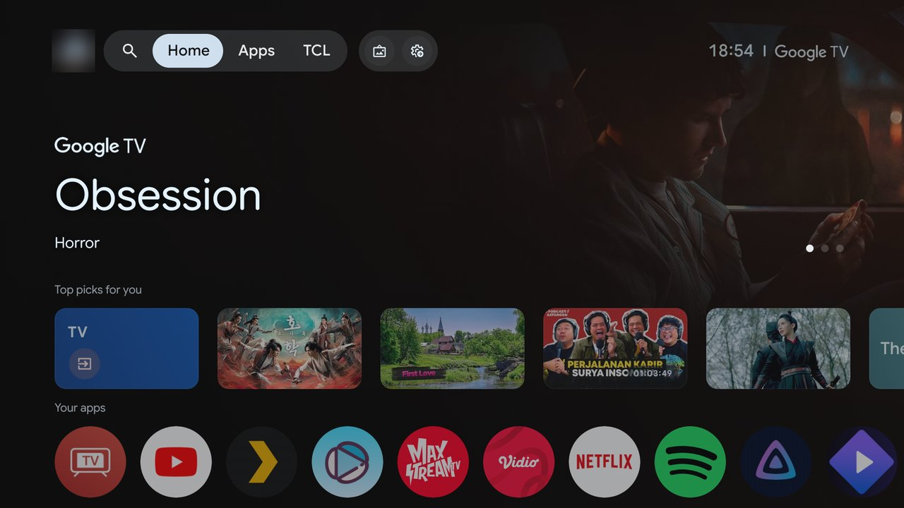
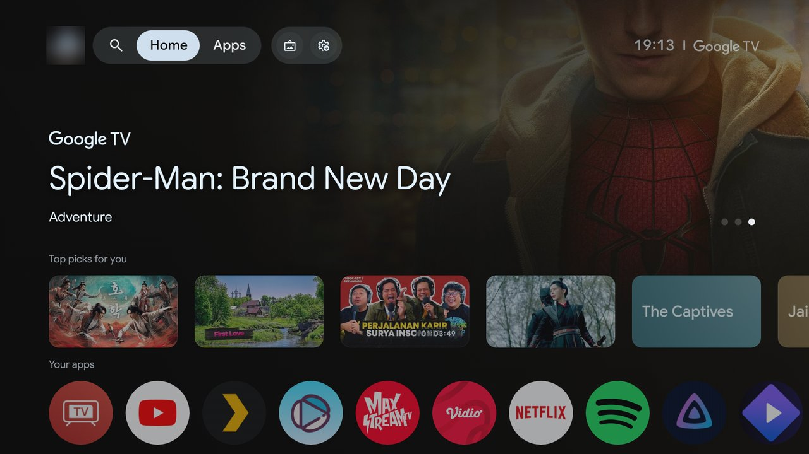
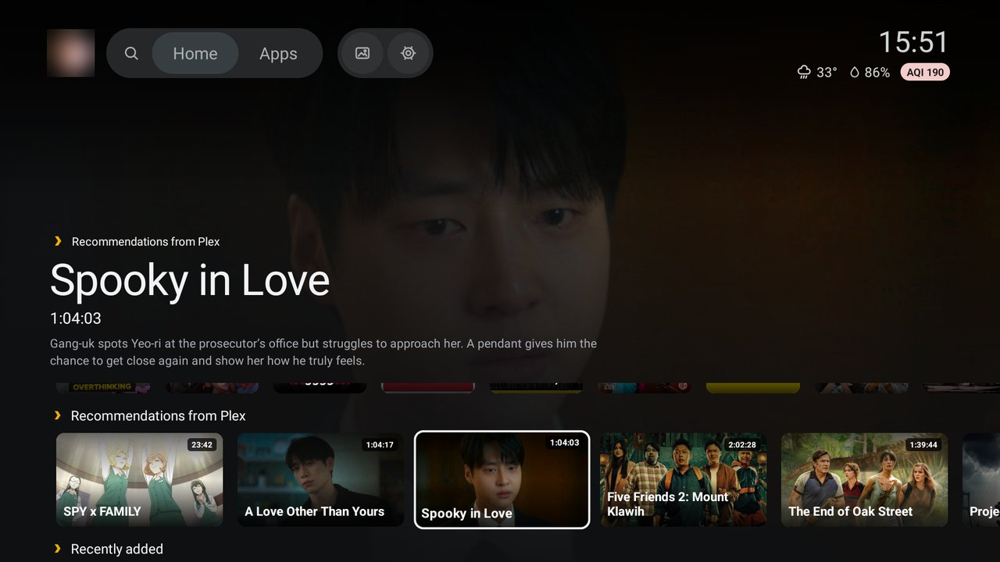
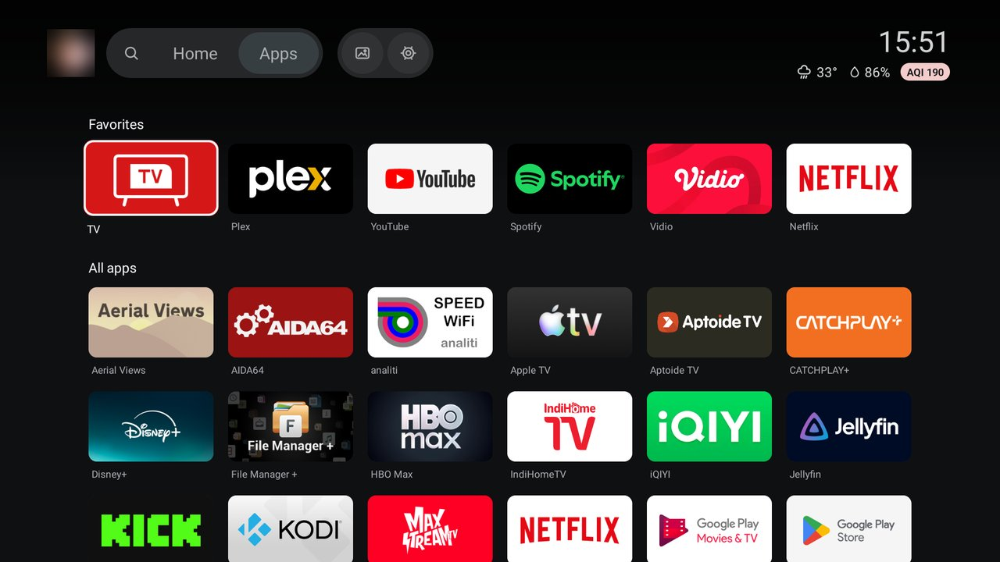
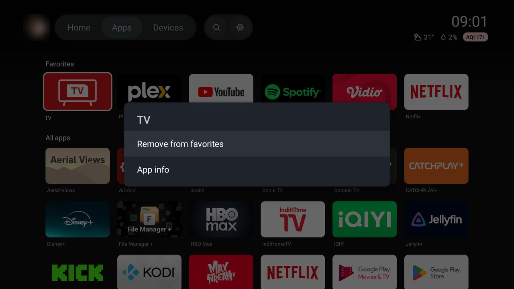

# TCL G09: debloat dan TCL Home

Dua hal untuk TV TCL Google TV (G09), dua-duanya jalan lewat ADB di Wi-Fi dan sudah dicek di TV:

- **Debloat.** Mematikan bloatware dan telemetry TCL, berdasarkan
  [cleanyourtv](https://github.com/Gathin23/cleanyourtv) (daftar `examples/tcl-g09-google-tv`, firmware
  yang sama persis). Semua aplikasi cuma di-**disable** untuk user 0, tidak ada yang di-uninstall, dan
  `tools/restore.sh` mengembalikan TV ke kondisi sebelum debloat.
- **TCL Home.** Launcher pengganti Home Google TV: siaran antena live di belakang, Plex, YouTube, dan
  Spotify di satu layar.

## Tampilan

| Google TV bawaan | Setelah debloat |
|---|---|
|  |  |

<!-- Foto layar default TCL Home (hero dengan siaran live) masuk di sini: docs/screenshots/tcl-home-live.jpg -->

| TCL Home: kartu difokus | TCL Home: tab Apps |
|---|---|
|  |  |



Siaran antena tidak bisa di-screenshot (lihat [Live TV](#live-tv)), jadi screenshot TCL Home di atas
diambil dari build dengan `show_live_tv` bernilai `false`. Foto profil di screenshot sengaja diburamkan.

## Daftar isi

- [TV ini](#tv-ini)
- [Isi repo](#isi-repo)
- [Persiapan](#persiapan)
- [Debloat](#debloat)
- [TCL Home](#tcl-home)
- [Menutup ADB](#menutup-adb)

## TV ini

| | |
|---|---|
| Model | TCL "Smart TV Pro", device `G09`, product `G09_4K_GB`, Amlogic T5M, 2023 |
| Firmware | Android 12 (SDK 31), `STT2.230203.001.AS24`, software `V8-T800T02-LF1V157` |
| CPU ABI | `armeabi-v7a` (userspace 32-bit, kernel armv8l). Semua binary native harus 32-bit ARM |
| RAM | 2 GB (1.9 GB terbaca) |
| Home bawaan | `com.google.android.apps.tv.launcherx/.home.HomeActivity` |
| Live TV / HDMI | `com.tcl.tv` (player), `com.tcl.tvinput` (HDMI 3/15/16/17 dan tuner) |

## Isi repo

```
debloat.txt             daftar paket yang di-disable, dikelompokkan dan diberi komentar
tools/lib.sh            alamat TV (TV_HOST), koneksi ADB, helper `tv`, validasi daftar paket, build_apk
tools/backup.sh         simpan kondisi TV ke backup/<waktu>/
tools/debloat.sh        backup, lalu disable semua paket di debloat.txt, lalu pasang Private DNS
tools/restore.sh        kembalikan semuanya ke backup paling awal
tools/screenshot.sh     tekan tombol remote lalu simpan screenshot ke shots/<nama>.png
tools/build-install.sh  build TCL Home, install, jadikan Home, cek di layar
tools/tvprobe.sh        cek data Continue watching, channel, dan siaran antena yang bisa dibaca launcher
tools/tvprobe/          source APK probe untuk tvprobe.sh
tools/plex-check.py     cek apa yang bisa diambil launcher dari server Plex (token di plex.local)
launcher/               source TCL Home; launcher/res/values/config.xml untuk semua setelan
docs/screenshots/       gambar untuk README ini
plex.local              token Plex, satu baris (jangan dibagikan)
backup/                 hasil backup (isinya serial number dan identitas device)
shots/                  screenshot kerja (ada nama akun dan nama Wi-Fi)
```

`plex.local`, `backup/`, dan `shots/` masuk `.gitignore`.

## Persiapan

1. Mac: `brew install android-platform-tools` (butuh `adb`).
2. TV: Settings → System → About → klik "Android TV OS build" 7x → balik → Developer options →
   nyalakan **USB debugging**.
3. Koneksi pertama memunculkan "Allow USB debugging?" di TV. Centang "Always allow" lalu OK.
4. Alamat TV default ada di `tools/lib.sh`. Kalau berubah (DHCP), jalankan dengan
   `TV_HOST=<ip-tv> tools/debloat.sh`. Lebih enak lagi kalau IP TV di-reserve di router.
5. Untuk TCL Home saja: JDK 17 dan Android SDK. `brew install openjdk@17`, `brew install --cask
   android-commandlinetools`, lalu `sdkmanager "platforms;android-34" "build-tools;34.0.0"`.

## Debloat

### Cara pakai

```bash
tools/debloat.sh                 # backup + disable semua isi debloat.txt + Private DNS
tools/restore.sh                 # balik ke kondisi sebelum debloat pertama
tools/screenshot.sh 01-home HOME # tekan HOME, simpan shots/01-home.png
tools/backup.sh                  # backup saja, tanpa mengubah apa pun
```

- `debloat.sh` aman dijalankan ulang, misalnya setelah factory reset. Paket yang sudah disabled cukup
  dilewati. Di akhir, script membandingkan daftar disabled di TV dengan `debloat.txt` dan keluar dengan
  error kalau ada yang masih nyala.
- Paket yang tidak terpasang (misalnya at4k setelah factory reset) dilewati dengan pesan
  "not installed".
- `debloat.sh` bisa menerima file daftar lain: `tools/debloat.sh daftar-lain.txt`.
- `PRIVATE_DNS= tools/debloat.sh` menjalankan debloat tanpa menyentuh setelan DNS.
- `restore.sh` memakai folder backup paling awal sebagai patokan, atau folder yang ditunjuk:
  `tools/restore.sh backup/20261022-185411`. Paket yang memang sudah disabled sebelum debloat pertama
  (`com.tcl.ocean.instructions`, `com.google.android.youtube.tvmusic`) tetap disabled.
- `screenshot.sh` menerima nama tombol tanpa awalan `KEYCODE_`: `HOME`, `BACK`, `DPAD_DOWN`,
  `DPAD_CENTER`, `TV_INPUT`, `VOICE_ASSIST`.

### Yang di-disable

32 paket di `debloat.txt` (30 berubah, 2 memang sudah disabled dari pabrik).

| Grup | Isi |
|---|---|
| Telemetry TCL | `ttvs` (BI dan identifier), `logkit` (upload log), `interactive` (TIAS), Google feedback, Ginga (aplikasi siaran ISDB-Tb Brasil, tidak terpakai di DVB-T2) |
| Konten dan promo TCL | TCL Live FAST channels, waterfall, push konten ke home, `partnercustomizer` (tab "TCL" di Home), messagebox, auto-install partner |
| Service latar belakang | TGuard, EULA, akun TCL, demo toko dan stiker, hotel mode, Alexa |
| Aplikasi preload | e-manual, repair guide, game bar, updater soundbar TCL, tes pendengaran, TalkBack, Play Games, YouTube Music, Ambient mode (`dreamx`) |
| Dimatikan sesuai pilihan | Prime Video, Miracast, MagiConnect, USB media player TCL |
| Launcher pihak ketiga | AT4K Launcher (`com.overdevs.at4k`), dipasang sendiri, bukan bloat. Dimatikan supaya Google TV jadi Home lagi |

Update firmware di build ini datang lewat Play Services, jadi `ttvs` aman di-disable.

### Yang sengaja tidak disentuh

- Dipakai: Netflix, YouTube, Google TV/Play Movies (`com.google.android.videos`), Chromecast
  (`mediashell`), AirPlay (`com.tcl.airplay2`, `com.amlogic.airplay`), remote di HP
  (`com.google.android.tv.remote.service`, juga jalur mic remote fisik), Google Assistant (`katniss`),
  scan channel antena (`com.tcl.initsetup`). Semuanya ada sebagai baris komentar di bagian bawah
  `debloat.txt`.
- Wajib untuk TV: `com.tcl.tv`, `com.tcl.tvinput`, `com.tcl.suspension` (menu Input),
  `com.tcl.dashboard`, `com.tcl.autopair`, `com.tcl.systemserver`, `com.tcl.providers.config`,
  `com.tcl.globalkeyoverlay`, Play Store, Play Services, keyboard, Bluetooth.
- `com.google.android.apps.tv.launcherx` dan `com.google.android.tungsten.setupwraith`. Kalau
  launcherx di-disable, Home jatuh ke `setupwraith/.RecoveryActivity` (prioritas HOME 1, di atas
  TCL Home), dan komponen itu tidak bisa di-disable dari shell. Setupwraith sendiri memiliki Wi-Fi
  yang tersimpan. Pemilih profil Google TV dan tombol aplikasi di remote juga milik launcherx.
- `com.tcl.factory.view`: paket factory. Jangan pernah dibuka, bahkan cuma untuk melihat.
- `com.tcl.android.webview`: WebView yang aktif adalah milik Google, yang TCL tidak terpakai.

### Pengaman di debloat.sh

Diambil dari `tools/disable.sh` di cleanyourtv. Tiap pengaman mencegah kerusakan nyata kalau
`debloat.txt` nanti diedit:

| Pengaman | Kenapa |
|---|---|
| Nama paket divalidasi | Tiap nama masuk ke perintah shell di TV. Satu baris aneh, seluruh daftar ditolak |
| Pemilik Home dilewati | Tanpa launcher, setup wizard Google TV mengambil alih Home dan bisa crash-loop |
| `setupwraith` dilewati selama dia memiliki Wi-Fi tersimpan | Android menghapus jaringan itu saat setupwraith di-disable, TV putus dari Wi-Fi dan ADB |
| Paket yang minta `TV_INPUT_HARDWARE` dilewati | Itu biasanya driver HDMI/tuner. Kalau di-disable, input jadi "No Signal" dan baru pulih lewat restore penuh plus cold boot |
| Satu perintah `pm` per paket | Perintah berantai bisa berhenti diam-diam setelah gagal pertama |

### Mengaktifkan lagi satu aplikasi

```bash
adb connect <ip-tv>:5555
adb -s <ip-tv>:5555 shell pm enable --user 0 com.tcl.ui_mediaCenter
```

Lalu jadikan komentar barisnya di `debloat.txt` supaya `debloat.sh` berikutnya tidak mematikannya lagi.

Tanpa komputer: Settings → Apps → See all apps → Show system apps → pilih aplikasinya → Enable.

### Private DNS (blok iklan)

`debloat.sh` memasang Private DNS ke `dns.adguard-dns.com`. Domain iklan seperti `doubleclick.net`
di-resolve ke `127.0.0.1`. Ini **tidak** memblok iklan YouTube karena iklannya dikirim dari domain
yang sama dengan videonya.

Mematikan tanpa restore penuh:

```bash
adb -s <ip-tv>:5555 shell settings put global private_dns_mode opportunistic
```

Atau lewat TV: Settings → Network and Internet → Private DNS → Automatic. `restore.sh` mengembalikan
nilai aslinya (kosong).

### Hasil pengecekan di TV (22 Oktober 2026)

| Fitur | Bukti |
|---|---|
| Backup | 11 file di `backup/20261022-185411/`, 2 paket disabled di baseline |
| Home Google TV sebelum, setelah tiap batch, dan setelah reboot | `shots/00` sampai `07` |
| Tab "TCL" hilang dari Home (efek `partnercustomizer`, baru hilang sekitar satu menit setelah reboot) | masih ada di `shots/07`, sudah hilang di `shots/09`, `14`, `17` |
| Settings, menu Input, Play Store, YouTube, Google TV/Play Movies | `shots/08` sampai `13` |
| Netflix | terbuka (`com.netflix.ninja/.MainActivity` resumed). Screenshot kosong karena DRM |
| Keyboard Gboard | `shots/15-keyboard.png`, `mInputShown=true` |
| Live TV / HDMI | `TVActivity` resumed dan ada sesi TV input aktif. Screenshot kosong karena protected. HDMI 3/15/16/17 dan tuner terdaftar |
| Google Assistant | overlay Assistant muncul (`shots/17-assistant.png`) dan pencarian genre jalan |
| Screensaver Aerial Views | tertangkap sedang jalan, setelan screensaver tidak berubah |
| Chromecast, AirPlay, remote di HP | `_googlecast` (8009), `_airplay` (7000), `_androidtvremote2` (6466) masih diumumkan |
| Private DNS | `ValidatedPrivateDnsAddresses` terisi, jaringan `VALIDATED` |
| Bertahan setelah reboot | daftar disabled setelah reboot sama persis dengan `debloat.txt` |
| Google TV jadi layar pertama setelah boot (at4k disabled) | `shots/20-after-reboot-no-at4k.png`, launcherx resumed |
| `restore.sh` lalu `debloat.sh` lagi | daftar disabled sama dengan baseline, lalu sama dengan `debloat.txt` lagi |
| Memori | MemAvailable sekitar 654 MB sebelum, 845 MB setelah reboot (TV sebelumnya sudah lama menyala, jadi perbandingannya kasar) |

Belum dicek: tombol mic di remote fisik (tombol yang diinjeksi lewat ADB tidak membuktikan apa-apa
untuk mic) dan gambar HDMI dilihat langsung dengan mata.

### Catatan dan keanehan

- Screenshot kosong (0 byte) saat Live TV, HDMI, Netflix, atau video screensaver tampil. Itu
  proteksi konten, bukan kerusakan. `screenshot.sh` lalu mencetak activity yang sedang tampil.
- AT4K Launcher tidak pernah jadi Home sistem. Dia muncul lewat `BootReceiver`-nya sendiri tiap
  boot, lalu service aksesibilitas `Hra` menimpa Google TV tiap kali Google TV tampil. Disable
  paketnya mematikan dua jalur itu sekaligus. Mau pakai lagi:
  `adb -s <ip-tv>:5555 shell pm enable --user 0 com.overdevs.at4k`, lalu jadikan komentar barisnya
  di `debloat.txt`. Service aksesibilitasnya masih tercatat di setelan, jadi langsung aktif lagi.
- Panel Input TCL masih menampilkan shortcut "TCL CHANNEL" dan "User Guide". Aplikasinya sudah
  di-disable, jadi shortcut itu tidak akan membuka apa-apa.
- Tile "TV" di baris "Top picks for you" itu dinamis. Tile itu muncul lagi setelah Live TV dibuka.
- Setelah `restore.sh`, tab "TCL" baru muncul lagi setelah reboot (belum diuji).
- `restore.sh` menetapkan launcherx sebagai Home secara eksplisit (`set-home-activity`), bukan
  sekadar karena prioritas.

## TCL Home

`launcher/` berisi TCL Home: Android framework biasa (Java, tanpa AndroidX, tanpa kode native, jadi
aman untuk `armeabi-v7a`), dibangun langsung dengan tool SDK oleh `build_apk` di `tools/lib.sh`.
APK-nya sekitar 62 KB. Saat jalan memakai sekitar 125 MB RAM (PSS) di tampilan default, dan sekitar
165 MB setelah semua baris dan gambarnya termuat. Sebagian besar selisihnya adalah bitmap kartu.

Desainnya mengikuti prototipe di MagicPath:
[Google TV Home + Plex](https://designs.magicpath.ai/v1/mighty-week-8644).

### Pasang

```bash
tools/build-install.sh   # build, install, beri izin, nyalakan redirect Home, cek Home di layar
```

Script ini memasang APK, memberi izin `READ_TV_LISTINGS`, menambahkan `HomeRedirectService` ke daftar
service aksesibilitas (service lain yang sudah aktif tetap dipertahankan), lalu membuka Settings dan
menekan Home. Kalau yang tampil bukan TCL Home, redirect dimatikan lagi dan script keluar dengan
error, jadi TV tidak pernah tertinggal tanpa Home.

`tools/restore.sh` mengembalikan setelan aksesibilitas ke baseline, jadi redirect mati dan Google TV
kembali jadi Home. TCL Home tetap terpasang tapi tidak dipakai.

### Setelan

Ubah lewat `launcher/res/values/config.xml`, lalu jalankan `tools/build-install.sh`:

| Kunci | Isi |
|---|---|
| `show_live_tv` | Siaran antena live di hero Home |
| `live_tv_input` | Input tuner (`com.tcl.tvinput/.TunerInputService/HW2`) |
| `profile_initial` | Huruf di tombol profil, sebelum foto user Plex kebaca |
| `dock_apps` | Favorit awal di baris Your apps, sebelum favorit pernah diubah dari remote |
| `hidden_apps` | Aplikasi yang tidak pernah tampil |
| `watch_next_excluded` | Aplikasi yang dibuang dari Continue watching (TCL browser, VLC) |
| `youtube_package`, `youtube_rows` | Channel YouTube di TvProvider yang jadi baris |
| `spotify_package`, `spotify_row` | Channel Spotify di TvProvider yang jadi baris Spotify |
| `stock_home_activity` | Home Google TV yang dialihkan ke TCL Home |
| `plex_enabled` | Baris dari API Plex: On Deck di Continue watching, Recently added, Movies in your library |
| `plex_recommendations` | Nama channel Plex di TvProvider untuk baris Recommendations from Plex |
| `plex_home_user` | User Plex Home yang dipakai, posisi di daftar Plex Home (2 di TV ini). Harus user tanpa PIN |
| `weather_latitude`, `weather_longitude` | Lokasi cuaca dan kualitas udara, koordinat tingkat kota (dua desimal) |

Favorit dan urutannya, kapan tiap app terakhir dibuka, channel terakhir, cuaca terakhir, dan login
Plex disimpan di penyimpanan privat app di TV, bukan di `config.xml`.

### Layar Home

**Top bar.** Kiri ke kanan: foto user Plex (huruf `profile_initial` sebelum fotonya kebaca), yang
membuka pemilih profil Google TV; pill Home / Apps; pill Search dan Settings. Di kanan ada jam besar,
dan di bawahnya rata kanan: ikon cuaca, suhu, peluang hujan, dan pill AQI.

- Seperti di Google TV, tab Home dan Apps berganti begitu difokus, tanpa OK. Search dan Settings
  baru terbuka saat OK ditekan, jadi keduanya ada di pill kanan, terpisah dari tab. Search membuka
  pencarian suara Google TV. Di Google TV, Search juga tab yang berganti saat difokus, tapi halamannya
  ada di dalam launcher Google TV sendiri dan tidak bisa dipanggil app lain. Kalau Search di sini
  dibuka saat difokus, overlay suara akan muncul setiap fokus lewat.
- Kiri di tab Home tidak ke mana-mana, jadi fokus tidak loncat ke baris di bawah. Kanan di Settings
  membuka quick settings TCL (`quick_settings_activity`, `com.tcl.dashboard`), cuma dari tombol itu.
- Warnanya diukur dari screenshot launcher bawaan: tab yang difokus berisi biru keabuan muda
  `#CFDFED` dengan teks hampir hitam, tombol ikon yang difokus berisi lingkaran `#E4F3FF` dengan
  namanya muncul di bawah ("Search", "Settings"), tab yang sedang tampil tapi tidak difokus berisi abu
  `#373E42`, tombol ikon yang diam punya lingkaran samar `#313234`, dan teks di pill yang tidak sedang
  difokus meredup ke `#ADB0B3`. Isian tab adalah satu highlight yang bergeser di bawah Home dan Apps
  (220 ms), sambil berganti warna antara isian fokus dan isian tab aktif. Isian fokus tidak membesar,
  supaya tetap di dalam pill.
- Gradasi gelap di belakang top bar menjaga jam tetap kebaca di atas siaran atau gambar yang terang.

**Hero.** Hero selalu siaran antena full-screen di belakang, dengan ikon TV dari app Live TV bawaan
TCL, nama dan nomor channel, lalu acara yang sedang tayang dari EPG siaran: judul, jam mulai–selesai,
dan deskripsi singkat apa adanya dari stasiunnya (TRANS 7 mengisinya dengan genre seperti
"INFORMATION MAGAZINE", METRO TV mengosongkannya). EPG dibaca di thread sendiri, terisi kurang dari
setengah detik setelah ganti channel, dan dibaca lagi begitu acaranya selesai. Selama Home tampil,
launcher memantau tabel program di TvProvider, jadi EPG yang baru ditulis tuner setelah tune langsung
muncul (setengah detik setelah tulisan terakhirnya). Fokus awal ada di tile pertama Your apps (TV), CH+/CH− mengganti channel
selama siaran tampil, dan OK di tile TV membuka Live TV full-screen di channel yang sama. Fokus di
kartu mana pun mengganti hero dengan item kartu itu: gambar item full-screen, logo app dan nama baris
asalnya, judul, meta, dan deskripsi dua baris. Begitu fokus kembali ke Your apps, hero kembali ke
siaran. Geser kiri-kanan di Your apps tidak menyentuh hero yang sudah menampilkan siaran, jadi teksnya
tidak berkedip. Selama hero menampilkan item, siaran tetap jalan di belakang, suaranya juga, jadi
siarannya langsung ada tanpa memuat channel lagi. Tuner baru dilepas saat aplikasi lain menutupi TCL
Home (`onStop`), atau tepat sebelum tile TV membuka Live TV. Tombol Home dan panel quick settings TCL
(`com.tcl.dashboard`) cuma mem-pause TCL Home, jadi siaran jalan terus tanpa tune ulang. Selama app lain
memutar musik, video, atau game di belakang (misalnya Spotify yang masih jalan setelah Home ditekan),
suara siaran dimatikan lewat `TvView.setStreamVolume(0)` dan kembali begitu app itu berhenti. Tuner TCL
tetap senyap setelah volume 0 walau volumenya dikembalikan ke 1, dan tune ke channel yang sedang
diputar diabaikan ("same program"), jadi saat suara kembali sesi tuner dibuat baru di channel yang
sama (siaran kosong sekitar 3 detik). Track
tuner sendiri dikenali dari flag `FLAG_HW_AV_SYNC` yang tidak dipakai app biasa, dan status player
dibaca dari deskripsinya (`state:started`), karena cuma itu yang terbuka untuk app pihak ketiga.

**Baris.** Your apps dan Continue watching selalu paling atas. Baris di bawahnya (Recommendations from
Plex, YouTube Recommended for you, Recently added, YouTube Subscriptions, Spotify, Movies in your
library) diurutkan dari app yang terakhir dipakai:

- Patokannya waktu app atau kartunya terakhir dibuka dari TCL Home, atau waktu terakhir nonton di
  Continue watching, mana yang lebih baru. App yang dibuka lewat jalan lain tanpa ditonton tidak
  menggeser urutan.
- Kalau waktunya sama (atau belum pernah dipakai), urutannya seperti daftar di atas.
- Urutan dihitung ulang setiap baris dibangun, jadi baru berubah saat kembali ke Home dari app lain,
  tidak saat sedang scroll.

Tampilan default cuma hero, baris Your apps, dan sedikit intipan Continue watching di tepi bawah layar
sebagai tanda masih bisa di-scroll. Baris lain terbuka saat fokus turun ke Continue watching, dan
tertutup lagi saat fokus naik ke Your apps. Saat terbuka, area baris setinggi satu baris plus intipan
kecil di atas dan bawahnya, dan baris yang difokus selalu berada di posisi yang sama, judulnya ikut
terlihat. Baris terakhir diberi ruang kosong di bawahnya supaya tetap di posisi itu, dan Down di baris
terakhir tidak melakukan apa-apa. Di dalam baris, kartu yang difokus dijaga agak jauh dari tepi kiri
dan kanan supaya cincin fokusnya tidak terpotong.

**Kartu.** Kartu berukuran 16:9, kecuali Spotify yang kotak mengikuti cover playlist dan podcast-nya.
Baris dari satu app punya logo app itu di kiri judulnya; Continue watching, yang isinya campuran,
tanpa logo. Kartu Plex menampilkan tahun di kiri atas. Di kanan atas ada badge sisa waktu, "Next",
atau durasi, dan di bawah ada progress bar: oranye untuk Plex, merah untuk YouTube, putih untuk
aplikasi lain. Gambar kartu di-decode selebar kartu (320 px) dan disimpan di cache memori seperdelapan
heap app. Gambar yang sama hanya diambil sekali walaupun baris dibangun ulang, dan gambar hero
(1280 px) punya thread sendiri.

**Aplikasi.** Baris Your apps hanya berisi favorit, tanpa nama di bawah tile (kalau ada, cuma nama itu
yang kelihatan di atas Continue watching saat di-scroll). Barisnya ditutup garis pemisah tipis, lalu dua
tile persegi (tinggi sama dengan tile app, ikon lebih kecil):

- tile All apps (ikon kotak 3×3) yang membuka tab Apps;
- tile Google TV (ikon rumah) yang membuka launcher bawaan. Redirect dilewati 3 detik setelah tile itu
  dipilih. Selama di launcher bawaan, tombol Home tidak membawa balik ke TCL Home karena launcher itu
  sudah tampil. Buka app apa saja lalu tekan Home, atau buka TCL Home dari daftar app.

Tab Apps adalah grid 6 kolom di tengah layar dengan dua bagian: Favorites (urutan sama dengan baris
Your apps) dan All apps (semua app, A–Z, selalu dihitung ulang, jadi app baru langsung masuk di posisi
abjadnya). Tahan OK di tile untuk membuka menunya:

| Tile | Menu |
|---|---|
| Favorit di baris Your apps | Move, Remove from favorites, App info, Uninstall |
| Favorit di grid | Remove from favorites, App info, Uninstall |
| App lain | Add to favorites, App info, Uninstall |

Uninstall hanya muncul untuk app yang bisa dihapus (app sistem tidak) dan membuka konfirmasi bawaan
sistem. Move menandai tile dengan ring kuning dan chevron di atas gradasi gelap di tepi kiri/kanan
card, hanya ke arah yang masih bisa dituju. Kiri/kanan menggeser tile di antara favorit (tidak bisa
melewati tile All apps), lalu OK atau Back menyimpan.

**Navigasi.** Atas dari Your apps ke tab aktif, bawah dari top bar ke kartu terakhir yang difokus (atau
aplikasi pertama). Back dan Home dari mana pun di TCL Home kembali ke tab Home dengan fokus di tile
pertama dan baris di atas, tanpa memuat ulang siaran. Di grid Apps, satu Down ke baris terakhir
langsung menggulir sampai bawah grid.

**Animasi.** Lapisan gelap berisi gambar hero fade masuk di atas siaran saat pindah ke item, dan fade
keluar saat kembali ke siaran. Gambar hero berganti dengan crossfade (dua `ImageView` bergantian), dan
teks hero fade sambil naik sedikit setiap item berganti. Gambar kartu yang baru selesai diunduh fade
masuk; yang sudah ada di cache langsung tampil. Tab Home dan Apps berganti dengan crossfade. Kartu dan
tile membesar saat difokus. Highlight tab bergeser antara Home dan Apps, dan warna pill di top bar
berganti dengan transisi, juga saat fokus naik dari kartu ke top bar. Durasinya 200–320 ms, dikali skala animasi sistem (di TV ini sudah disetel ke 1;
bawaannya 0,5).

### Live TV

Channel di hero ikut channel yang terakhir ditonton, baik di Home maupun di Live TV. Ganti channel di
Live TV lalu tekan Home, dan siaran di Home lanjut di channel itu. Sebaliknya, tile TV membuka Live TV
di channel yang sedang diputar Home. Live TV yang dibuka lewat jalan lain (misalnya tombol input di
remote) mulai dari catatannya sendiri, lalu Home yang ikut. Catatannya disimpan sebagai nomor channel:
ditulis setiap Home ganti channel, dan oleh `HomeRedirectService` dari banner channel Live TV.

Siaran di Home dan di app Live TV adalah dua sesi tuner yang terpisah. Saat tile TV dibuka, Home
melepas tuner dan Live TV menyetel ulang channel yang sama, jadi selalu ada jeda memuat sebentar.

Screenshot kosong (0 byte) selama siaran tampil di TCL Home. Ini bukan `FLAG_SECURE` (window TCL Home
tidak memakainya): video tuner dialirkan sebagai sideband stream langsung dari hardware ke panel, jadi
SurfaceFlinger tidak punya pikselnya. Untuk melihat tata letak lewat screenshot, pasang build
sementara dengan `show_live_tv` bernilai `false`.

### Plex

Login sekali lewat kartu "Sign in to Plex" di Continue watching (atau `adb shell am start -n
dev.tcl.home/.PlexLoginActivity`): TV menampilkan kode, masukkan di plex.tv/link dari HP. Token akun,
token user, foto user, dan alamat server yang berhasil disimpan di penyimpanan privat app.

- **Continue watching** berisi On Deck user `plex_home_user`, digabung dengan Watch Next sistem (jenis
  CONTINUE dan NEXT, tanpa `watch_next_excluded`) dan diurutkan dari yang terakhir ditonton.
- **Recently added** dan **Movies in your library** (20 film acak dari library film pertama) diambil
  dari API Plex.
- **Recommendations from Plex** dibaca dari TvProvider. Gambarnya di sana
  `content://com.plexapp.android.RecommendationsProvider/…`, yang hanya boleh dibuka launcher bawaan,
  jadi gambarnya diambil dari server Plex dalam satu request per server
  (`/library/metadata/k1,k2,…`), memakai id server dan `ratingKey` di link tiap item.

Baris dari TvProvider tampil dulu, baris dari API Plex menyusul sekitar 1–3 detik kemudian, dan baris
Plex terakhir ditampilkan langsung saat Home dibuka lagi. Kalau server Plex belum bisa dihubungi
(misalnya jaringan belum siap tepat setelah boot), baris Plex dicoba lagi tiap 15 detik selama Home
tampil.

**Kartu Plex langsung memutar itemnya dari posisi terakhir ditonton.** Launcher membuka halaman item
lewat rute app Plex sendiri, `plex://libraries/<machineId server>/movie/x/<ratingKey>` (jalan untuk
film maupun episode), lalu `HomeRedirectService` mengirim
`…/movie/x/<ratingKey>?autoplay=1&offset=<detik>` begitu Plex menampilkan tombol Resume, Watch, atau
Play, tanda Plex sudah tersambung ke server. Link autoplay tidak dikirim langsung karena Plex yang
harus start dulu mencoba memutar sebelum tersambung dan menampilkan "Can't Reach Server". Link dari
baris "Recommendations from Plex" (Plex menulisnya dalam bentuk lama
`plex://server://…/library/metadata/…?viewOffset=<ms>`) diubah dengan cara yang sama. Kalau Plex
belum siap dalam 40 detik, link autoplay tidak dikirim, dan Plex berhenti di halaman item.

### YouTube dan Spotify

Baris YouTube mengikuti akun yang sedang aktif di app YouTube, bukan launcher. YouTube menulis ulang
barisnya lewat job `RecommendationService` yang terjadwal sekitar tiap 4,5 jam, dan juga beberapa
detik setelah app YouTube ditutup. Broadcast `INITIALIZE_PROGRAMS` dan menjalankan job itu paksa
(`cmd jobscheduler run -f`) tidak mengubah isinya. Jadi setelah ganti profil Google TV, buka YouTube
sekali lalu tekan Home. Selama Home tampil, launcher memantau TvProvider, dan baris dibaca lagi dua
detik setelah sebuah app selesai menulis ulang barisnya. Menyetel akun YouTube dari launcher tidak
mungkin: launcher tidak punya akses ke akun Google, dan API resmi YouTube tidak menyediakan feed
rekomendasi.

Baris Spotify adalah channel "Spotify" yang ditulis app Spotify ke TvProvider: 20 playlist dan podcast
dengan cover kotak 640×640.

### Cuaca dan kualitas udara

Diambil dari Open-Meteo (tanpa akun atau key; yang dikirim cuma koordinat di `config.xml`). Peluang
hujan adalah angka untuk 15 menit saat ini. AQI memakai skala US AQI, dan pill-nya diwarnai pastel
sesuai kategorinya (hijau, kuning, oranye, merah, ungu, merah bata) dengan teks gelap. Kalau cuma data
kualitas udara yang gagal, pill AQI disembunyikan. Data dibaca ulang tiap 30 menit, atau 5 menit
setelah gagal, dan bacaan terakhir disimpan jadi langsung tampil saat Home dibuka. Sebelum bacaan
pertama, baris cuacanya belum muncul. Ikonnya: matahari atau bulan (cerah, ikut siang/malam), cerah
berawan (matahari atau bulan di balik awan), berawan, kabut, hujan, dan petir.

### Cara jadi Home

Google TV tetap enabled dan tetap jadi Home sistem. Di build ini Google TV punya prioritas HOME 2,
setupwraith 1, dan aplikasi pihak ketiga selalu 0. Tidak ada preferensi Home yang tersimpan, jadi
`cmd package set-home-activity` dan `cmd role add-role-holder` menjawab sukses tanpa mengubah apa pun.
Karena itu TCL Home memakai service aksesibilitas (`HomeRedirectService`, cara yang sama dengan at4k):
setiap kali HomeActivity Google TV muncul, TCL Home dibuka di atasnya. Layar Google TV lain seperti
pemilih profil tetap bisa dibuka. Saat boot, service tersambung setelah Google TV tampil, jadi dalam
lima menit pertama setelah boot service langsung membuka TCL Home.

Service ini cuma menerima event dari tiga app:

| App | Yang dilakukan service |
|---|---|
| Google TV | Membuka TCL Home setiap kali Home Google TV tampil, kecuali 3 detik setelah tile Google TV dipilih |
| Live TV | Membaca nomor di banner channel (`com.tcl.tv:id/tvCurChannelNum`) sebagai channel terakhir |
| Plex | Setelah kartu Plex dibuka, menunggu tombol Resume/Watch/Play lalu mengirim link autoplay. Tidak mengklik apa pun |

Service tidak memfilter tombol, karena filter tombol di keluarga G09 membuat volume tidak bisa ditahan.
Plex adalah app React Native, dan tombolnya baru terlihat oleh service dengan
`flagIncludeNotImportantViews`.

Jangan `am force-stop dev.tcl.home`: service redirect ikut mati dan tidak tersambung lagi, jadi Home
Google TV yang tampil. Jalankan `tools/build-install.sh` lagi untuk menyambungkannya.

### Sudah dicek di TV

Lewat `dumpsys`, struktur UI dari `uiautomator`, dan screenshot (22–23 Oktober 2026):

| Tes | Hasil |
|---|---|
| Tekan Home dari Settings atau YouTube | TCL Home |
| Reboot | TCL Home tampil sekitar 30 detik setelah perintah reboot |
| Standby lalu nyala lagi | TCL Home, siaran lanjut di channel terakhir |
| Fokus awal dan CH+/CH− | Tile TV dengan siaran jalan; `RCTI HD` → `MNCTV HD` → kembali |
| Acara dari EPG | `MAKAN RECEH · 16:00–17:00` di TRANS 7, `METRO HARI INI · 16:00–16:30` di METRO TV, sudah tampil 0,4 detik setelah CH+ |
| Navigasi | Continue watching → atas ke Your apps (hero kembali ke siaran) → atas ke tab Home → bawah ke tile TV |
| Siaran di belakang | Sesi TV input sama persis di siaran, kartu, dan kembali ke siaran (tidak tune ulang) |
| Kemulusan (gfxinfo, jalur tombol yang sama) | Tanpa animasi: 113 frame, 49% janky, median 23 ms. Dengan animasi: 264 frame, 26% janky, median 31 ms, p90 sama 46 ms |
| Urutan baris | Setelah Spotify dibuka dari Your apps: Continue watching, Spotify, Recommendations from Plex, Recently added, Movies, YouTube Recommended for you, Subscriptions |
| Baris | Kedelapan baris ada, kartu Spotify kotak; tampilan default hero + Your apps + intipan Continue watching |
| Tile Google TV | Launcher bawaan tetap tampil lebih dari 9 detik; buka YouTube lalu Home kembali ke TCL Home |
| Channel Live TV → Home | Live TV pindah ke 20, Home lalu memutar CH 20 |
| Channel Home → Live TV | Home di 21, tile TV membuka Live TV di 21 |
| Kartu Plex, Plex belum jalan | Film diputar mulai dari posisi resume-nya (sekitar menit ke-74) |
| Kartu Plex, Plex di background | Kartu rekomendasi diputar dari detik 1.070, posisi resume-nya |
| Kartu Plex setelah reboot | Halaman item lalu link autoplay 11 detik kemudian, player Plex terbuka |
| Baris Plex setelah reboot | On Deck muncul sendiri di Home pertama (uptime 65 detik) tanpa Home dibuka ulang |
| Baris YouTube setelah YouTube ditutup | Dibaca ulang otomatis begitu YouTube menulis ulang barisnya |
| Favorit | Add dari grid lalu Remove dari Home; Move tidak bisa melewati tile All apps; chevron hanya ke arah yang mungkin |
| Menu tile | App info membuka halaman app di Settings; tile app sistem tanpa Uninstall |
| Cuaca dan AQI | Suhu, kode cuaca, peluang hujan, dan AQI sama dengan jawaban Open-Meteo yang dibaca langsung dari Mac |
| Top bar | Profil membuka pemilih profil Google TV, Settings membuka Settings, Search membuka pencarian suara. Kiri di Home tetap di tempat; kanan di Settings membuka `com.tcl.dashboard`, kanan di tile app tidak |
| Spotify di belakang | Play → `com.tcl.tvinput` `onSetStreamVolume:0.0`; pause → sesi baru (`releaseSession`, `createSession`, `onVideoAvailable` 3 detik kemudian) dan siaran terdengar lagi |
| Highlight tab | Terekam bergeser di tengah jalan antara Apps dan Home (`screenrecord`); 90 frame saat pindah tab 6 kali, 1 janky, median 15 ms |
| Home dan quick settings | TCL Home hanya pause; 0 baris log `TvInputManagerService` (CH+ sebagai pembanding: 50 baris) |
| Back | Dari kartu Continue watching kembali ke tile TV, tanpa tune ulang |
| Tile TV setelah tuner dilepas lebih awal | Live TV tampil dan `onVideoAvailable` |
| Grid Apps | Satu Down ke baris terakhir langsung sampai bawah; Down berikutnya tidak menggeser apa pun |
| Login Plex | Kode tampil, setelah dimasukkan di plex.tv/link layar menutup sendiri |

Belum dicek: tombol fisik di remote (Home, tombol aplikasi, mic, menahan volume, menahan OK di tile,
dan OK di kartu Plex), dan apakah Viu langsung masuk ke episode yang dipilih (layar pemutarnya
terproteksi). Tombol yang dikirim lewat ADB tidak membuktikan perilaku remote fisik.

### Temuan teknis

- **Yang bisa dibaca launcher dari TvProvider** dengan izin `READ_TV_LISTINGS`, diukur dengan
  `tools/tvprobe.sh`:

  | Sumber | Baris channel | Isi baris (preview) | Watch Next |
  |---|---|---|---|
  | Plex | "Recommendations from Plex", "Free Movies & TV & more from Plex" | 42 item | tidak ada |
  | YouTube | "Recommended for you", "Subscriptions", "Trending", "YouTube Music" | 28 item | tidak ada |
  | Plex Channel Connect | tidak ada | tidak ada | tidak ada |
  | TV antena (`com.tcl.tvinput`) | 52 channel (TVRI dan lain-lain) | - | - |

  Continue watching Plex tidak ada di jalur ini, jadi On Deck diambil dari API Plex. Riwayat tontonan
  YouTube tidak tersedia lewat API resmi sama sekali. App baru menulis barisnya ke TvProvider beberapa
  menit setelah boot.
- **Channel app lain di TvProvider**, dibaca lewat TCL Home: Disney+ Hotstar (10 item, gambar
  1920×1080), Apple TV (14 item, 3840×2160, tanpa deskripsi), Catchplay (3 channel, 704×396), Viu
  (63 item, 752×424), Vidio (640×360), Spotify (640×640), YouTube (640×480, 4:3). Netflix dan HBO Max
  tidak menulis channel sama sekali, dan empat channel Google TV/Play Movies ada tapi kosong.
  Rekomendasi di hero Google TV diambil dari server Google dengan akun Google, tidak lewat TvProvider.
- **Watch Next per jenis** (`tools/tvprobe.sh` mencatat `watch_next_types`): Viu 9 CONTINUE + 7 NEXT,
  Disney+ Hotstar 8 CONTINUE + 1 NEXT, Vidio 1 + 1, semuanya dengan posisi tonton. Jellyfin 1 NEW
  tanpa posisi. TCL browser 30 NEW tanpa posisi (artikel dan promo). VLC 4 CONTINUE berisi nama file
  pribadi. Karena itu Continue watching hanya mengambil CONTINUE dan NEXT, tanpa TCL browser dan VLC.
- **Siaran antena di app pihak ketiga**: `TvView` yang disetel ke
  `com.tcl.tvinput/.TunerInputService/HW2` mendapat `onVideoAvailable`, dan Live TV bawaan tetap bisa
  memakai tuner setelah app itu melepasnya.
- **Channel terakhir Live TV** tidak bisa dibaca langsung. Live TV (`com.tcl.tv`) jalan dengan uid
  sistem dan menyimpannya di penyimpanan privat; ganti channel tidak mengubah setelan
  global/system/secure atau property apa pun. `last_play_channel_infos.EN_TCL_DVBT` tidak ikut
  berubah, dan `persist.sys.livetvLatestInput` hanya menyimpan input terakhir. Tabel `watched_program`
  di TvProvider mencatat setiap tune (dari Live TV maupun launcher, ditulis oleh `com.tcl.tvinput`),
  tapi barisnya baru lengkap saat channel ditinggal, dan tabel itu dijaga izin
  `ACCESS_WATCHED_PROGRAMS` (signature|privileged): shell bisa membacanya, app biasa tidak, dan `pm
  grant` ditolak. Banner channel Live TV (`tvCurChannelNum`, `tvCurChannelName`) terbaca lewat
  aksesibilitas setiap Live TV dibuka atau ganti channel, dan Live TV menuruti `ACTION_VIEW
  content://android.media.tv/channel/<id>`, juga saat task-nya sudah terbuka.
- **Plex lewat API** (server di VPS). `tools/plex-check.py` membaca token dari `plex.local` dan hanya
  mencetak angka. Dua server milik akun, keduanya terjangkau lewat koneksi remote HTTPS (sekitar
  0,8–1,3 detik per request); koneksi lokal tidak terjangkau. On Deck dihitung per user Plex. Akun ini
  punya tiga user Plex Home: admin (pakai PIN, tidak dipakai menonton) dan dua user managed tanpa PIN.
  Token admin bisa pindah ke user managed lewat `POST https://plex.tv/api/v2/home/users/{uuid}/switch`
  tanpa PIN, dan hasilnya token user itu sendiri. TV ini memakai user #2; user #3 untuk TV lain.
- **App Plex untuk TV** (versi 2026.20.0, `tv.plex.app.MainActivity`) adalah app React Native; routing
  link ada di bundle JavaScript (Hermes). Rutenya antara lain `libraries/:serverId/movie/:slug/:key`
  dan `libraries/:serverId/show/…`. Link lama `plex://server://<id>/com.plexapp.plugins.library/
  library/metadata/<key>` (yang masih Plex tulis ke TvProvider) berakhir di beranda Plex.
  `plex://libraries/<id>/movie/x/<key>` membuka halaman item saat Plex mati, di background, atau
  sedang di halaman item lain; segmen `movie` dan slug `x` tidak dicek. Bundle-nya punya
  `useAutoplayDeeplinkRedirect`: `?autoplay=1` memutar item dan `&offset=<detik>` mengatur posisi
  awal. `viewOffset`, `resume`, dan `t` diabaikan, dan tanpa `offset` Plex memutar dari awal. `offset`
  dalam milidetik melompat melewati akhir film, dan Plex lalu menandainya sudah ditonton. Klik lewat
  aksesibilitas (`ACTION_CLICK`) maupun tap sentuh pada tombol Resume tidak memicu apa pun, dan
  `findFocus()` tidak menemukan tombol yang sedang fokus. Plex Companion (port 32500,
  `/player/playback/playMedia`) tidak terbuka di TV ini. Dengan "sign in automatically" aktif di Plex,
  "Who's watching?" tidak muncul.
- **Dispatch** (`com.spauldhaliwal.dispatch` 1.0.175) adalah app Flutter. String di `libapp.so`
  menunjukkan dia membuka item Plex dengan `android_intent_plus` dan link lama
  `plex://server://…?viewOffset=`, plus extra miliknya sendiri (`extra_detail_page`,
  `android.intent.extra.START_PLAYBACK`) yang tidak dibaca app Plex.
- **Pemilih profil Google TV** bisa dibuka dari app lain:
  `am start -n com.google.android.apps.tv.launcherx/.profile.chooser.ProfileChooserActivity`. Layar itu
  milik launcherx. Foto akun Google tidak bisa dibaca app pihak ketiga, jadi tombol profil memakai foto
  user Plex.
- **Tombol aplikasi di remote TCL** (Netflix, YouTube, Prime Video) dikirim ke launcherx. Di build G09
  lain, service aksesibilitas yang memfilter tombol membuat volume tidak bisa ditahan untuk naik terus.
  TV ini sudah menjalankan satu service seperti itu (`tvquickactions`).
- **Log app di `onCreate`** tidak pernah muncul di logcat build ini, sedangkan log dari callback
  muncul. Karena itu probe `live` mencatat detail penyetelan di baris callback.
- **`tools/tvprobe.sh`** membangun APK probe kecil (`tools/tvprobe/`), memasangnya, memberi izin
  `READ_TV_LISTINGS`, menjalankannya, mencetak hasil, lalu menghapusnya lagi dari TV. Yang dicatat hanya
  jumlah baris per aplikasi, nama channel, bentuk link dan URI gambar (id dan angka disamarkan), rentang
  `_id` program, dan hash judul per aplikasi, bukan judul tontonan. `tools/tvprobe.sh live` menguji
  siaran antena di `TvView` selama 12 detik.

## Menutup ADB

Port 5555 itu plaintext. TV ini `ro.adb.secure=1`, jadi perangkat lain tetap butuh izin "Allow" di
layar. Tapi kalau sudah tidak dipakai: Developer options → matikan USB debugging → "Revoke USB
debugging authorizations" → reboot. Cek dari Mac: `nc -vz <ip-tv> 5555` harus menjawab
"Connection refused".

ADB dipakai `tools/build-install.sh` untuk memasang TCL Home, jadi biarkan menyala selama launcher
masih diubah.
